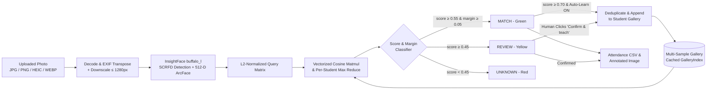

# Vision-Based Automated Attendance System


An end-to-end **AI group face recognition and automated attendance system** built with **InsightFace (`buffalo_l`)**, **ONNX Runtime**, **OpenCV**, **FastAPI**, and **Gradio**. Upload a single classroom or group photo to detect every face, match students against a multi-sample embedding gallery in a single vectorized matrix pass, review borderline detections with human-in-the-loop controls, continuously improve accuracy via automatic sample learning, and export clean attendance sheets as CSV.

---

## Table of Contents

- [Key Features](#key-features)
- [System Architecture & Pipeline](#system-architecture--pipeline)
- [Scoring, Margin & Enrichment Thresholds](#scoring-margin--enrichment-thresholds)
- [Repository Structure](#repository-structure)
- [Getting Started](#getting-started)
  - [Prerequisites](#prerequisites)
  - [Installation](#installation)
  - [Initial Gallery Setup](#initial-gallery-setup)
- [Usage](#usage)
  - [1. Unified Web Application (Recommended)](#1-unified-web-application-recommended)
  - [2. Standalone Gradio Interfaces](#2-standalone-gradio-interfaces)
  - [3. Mobile / External Client API Server](#3-mobile--external-client-api-server)
  - [4. Command-Line Utilities (Batch Enrollment & Benchmarking)](#4-command-line-utilities-batch-enrollment--benchmarking)
- [Configuration (Environment Variables)](#configuration-environment-variables)
- [REST API Reference](#rest-api-reference)
  - [Web Application API (`webapp.py`)](#web-application-api-webapppy)
  - [Mobile API (`server.py`)](#mobile-api-serverpy)
- [Data Storage, Backups & Privacy](#data-storage-backups--privacy)
- [Troubleshooting](#troubleshooting)
- [Contributing](#contributing)

---

## Key Features

- **Single-Shot Group Attendance**: Detect and identify dozens of faces from a single classroom or event photo in seconds, complete with color-coded bounding boxes and confidence scores.
- **3-Tier Confidence Classification with Margin Guard**: Separates detections into **`MATCH`** (green), **`REVIEW`** (yellow/amber), and **`UNKNOWN`** (red) using both top-1 cosine similarity and top-2 separation margin to prevent false positives between look-alike students.
- **Human-in-the-Loop Review & Active Teaching**: Borderline `REVIEW` faces can be confirmed or rejected directly in the browser. Confirming a face in the web app immediately teaches the gallery that new appearance (`POST /api/learn`).
- **Continuous Self-Improvement (Auto-Training)**: High-confidence matches (`score >= 0.70` and `margin >= 0.05`) are automatically appended to the student's profile during routine attendance runs. Near-duplicates (`similarity >= 0.999`) are skipped, and once a profile reaches its sample cap (`50` by default), the most redundant stored embedding is replaced so each student's gallery stays diverse across lighting, angles, and expressions.
- **Vectorized BLAS Matching (`GalleryIndex`)**: All stored embeddings are L2-normalized once and stacked into a contiguous `float32` matrix cached by file `mtime` and size. Matching an entire class photo requires a single matrix multiplication (`queries @ index.matrix.T`) plus `np.maximum.reduceat`, eliminating nested Python loops.
- **Group Registration & Multi-Photo Sample Enrichment**:
  - **Register** new students directly from a group photo—already registered `MATCH` faces are automatically filtered out so you only label unknown faces.
  - **Enrich** existing profiles in bulk by uploading multiple enrollment photos, with high-confidence faces pre-selected and medium-confidence faces queued for review.
- **Smartphone-Ready Image Handling**: Built-in HEIC/HEIF support (`pillow-heif`), automatic EXIF orientation correction (`ImageOps.exif_transpose`), and aspect-ratio-preserving downscaling (`MAX_IMAGE_SIZE = 1280`) before inference.
- **Safe Persistence & Rolling Backups**: Atomic file replacement via temporary files prevents corrupt pickles or JSON registries, keeps `multi_sample_gallery.pkl`, `profiles.json`, and `gallery/crops/` synchronized on every edit/delete, and retains the 5 most recent timestamped gallery backups in `gallery/backups/`.
- **Multiple Interfaces**: Run the all-in-one **FastAPI + Vanilla JS Web App**, individual **Gradio** apps, the **Mobile REST API**, or **CLI scripts** for batch enrollment and model benchmarking.

---

## System Architecture & Pipeline



### Shared Recognition Core (`app.py`)

Rather than duplicating inference logic across tools, `app.py` serves as the single source of truth for:
1. **Model Lifecycle (`get_model`, `get_model_for`)**: Uses `@lru_cache` to load `FaceAnalysis` on `CPUExecutionProvider` and executes a dummy warm-up pass so ONNX Runtime initialization never penalizes the first real request. `webapp.py` additionally warms up the model and gallery index in a background thread on server startup.
2. **Preprocessing (`preprocess_image`)**: Downscales images exceeding `1280px` on the longest edge using `cv2.INTER_AREA` while returning the exact scale factor.
3. **Indexed Matching (`GalleryIndex`, `recognize_faces_batch`)**: Pre-normalizes every student's embeddings into unit vectors and tracks student block offsets in `starts`, reducing per-request matching to sub-millisecond matrix operations.
4. **Stage Telemetry (`StageTimer`, `format_timings`)**: Logs per-stage execution times (`decode`, `resize`, `detection`, `matching`, `annotation`, and `total`).

---

## Scoring, Margin & Enrichment Thresholds

For each detected face, the matcher computes the best cosine similarity per registered student. Let `score` be the highest similarity across all students and `margin` be the gap between the best and second-best student (`score_top1 - score_top2`):

| Stage / Decision | Condition | Behavior |
| :--- | :--- | :--- |
| **`MATCH`** | `score >= 0.55` **and** `margin >= 0.05` | Confident identification; included automatically in attendance CSV. |
| **`REVIEW`** | `score >= 0.45` *(when not `MATCH`)* | Borderline similarity or ambiguous top-2 margin (`< 0.05`); queued for human confirmation. |
| **`UNKNOWN`** | `score < 0.45` | Unrecognized person; excluded from attendance and eligible for new student registration. |
| **Sample Enrichment — Auto-Select** | `score >= 0.70` | Pre-checked for addition in the *Add Samples* workflow (and auto-added by `scripts/add_samples.py`). |
| **Sample Enrichment — Manual Review** | `0.55 <= score < 0.70` | Displayed in *Add Samples* unchecked so a human can verify before adding. |
| **Auto-Training (`webapp.py`)** | `MATCH` **and** `score >= 0.70` **and** `margin >= 0.05` | Appended automatically during recognition if `ATTENDANCE_AUTO_LEARN=1`. |
| **Near-Duplicate Guard** | `max_similarity >= 0.999` | Skips storing embeddings practically identical to an existing sample (e.g., re-uploading the same photo). |
| **Per-Student Sample Cap** | `samples >= 50` *(configurable)* | Evicts the existing sample with the highest cumulative similarity to all other samples for that student before appending the new one. |

---

## Repository Structure

```text
Vision-Based-Automated-Attendance-System/
├── app.py                  # Shared recognition core + standalone Gradio attendance review UI
├── webapp.py               # Unified FastAPI web application & REST API (serves templates/index.html)
├── templates/
│   └── index.html          # Single-page browser UI (Recognize, Register, Add Samples, Profiles)
├── registration_app.py     # Standalone Gradio UI for group student registration & profile CRUD
├── add_samples_app.py      # Standalone Gradio UI for multi-image sample enrichment
├── server.py               # Lightweight FastAPI server with open CORS for mobile clients
├── scripts/
│   ├── add_samples.py      # CLI batch script to enroll face samples from an image folder
│   └── benchmark.py        # Latency & accuracy benchmark across InsightFace models/resolutions
├── gallery/
│   ├── backups/            # Rolling timestamped backups of multi_sample_gallery.pkl (last 5 kept)
│   ├── crops/              # Representative student face crops: face_01.jpg, ... (git-ignored)
│   ├── profiles.json       # Metadata registry mapping face_XX -> {student_id, name} (git-ignored)
│   └── multi_sample_gallery.pkl  # Live multi-sample embedding dictionary (git-ignored)
├── requirements.txt        # Python package dependencies
└── .gitignore              # Excludes local face crops, live gallery pickles, and virtualenvs
```

---

## Getting Started

### Prerequisites

- **Python 3.10+** (recommended)
- **C++ Build Tools** *(only if `insightface` builds its Cython extensions from source on your platform—e.g., `build-essential` on Linux, Xcode Command Line Tools on macOS, or Visual C++ Build Tools on Windows)*

### Installation

1. **Clone the repository:**
   ```bash
   git clone https://github.com/sushil930/Vision-Based-Automated-Attendance-System.git
   cd Vision-Based-Automated-Attendance-System
   ```

2. **Create and activate a virtual environment:**
   ```bash
   python -m venv .venv
   # Linux / macOS
   source .venv/bin/activate
   # Windows (PowerShell)
   .venv\Scripts\Activate.ps1
   ```

3. **Install dependencies:**
   ```bash
   pip install --upgrade pip
   pip install -r requirements.txt
   ```
   > **Note:** On the first run, InsightFace will automatically download the `buffalo_l` model pack (~280 MB) into `~/.insightface/models/buffalo_l/`.

### Initial Gallery Setup

For privacy, live biometric files (`gallery/multi_sample_gallery.pkl`, `gallery/profiles.json`, and `gallery/crops/`) are excluded via `.gitignore`. Before starting the server on a fresh clone, initialize `gallery/multi_sample_gallery.pkl` using **one** of the following options:

- **Option A — Restore from an included backup** *(if continuing with the existing gallery)*:
  ```bash
  # Copy the latest backup into the active gallery path
  cp "$(ls -1 gallery/backups/multi_sample_gallery_*.pkl | sort | tail -n 1)" gallery/multi_sample_gallery.pkl
  ```

- **Option B — Bootstrap a brand-new gallery from a first photo** *(if starting fresh for a new class)*:
  ```bash
  python -c "
  import pickle, cv2, numpy as np
  from pathlib import Path
  from insightface.app import FaceAnalysis

  img = cv2.imread('first_student.jpg')
  app = FaceAnalysis(name='buffalo_l', providers=['CPUExecutionProvider'])
  app.prepare(ctx_id=0, det_size=(640, 640))
  face = app.get(img)[0]
  emb = face.embedding.astype(np.float32)
  emb /= np.linalg.norm(emb)

  Path('gallery').mkdir(exist_ok=True)
  with open('gallery/multi_sample_gallery.pkl', 'wb') as f:
      pickle.dump({'1001': {'name': 'First Student', 'embeddings': [emb]}}, f)
  "
  ```
  Once at least one profile exists in `gallery/multi_sample_gallery.pkl`, all remaining students can be enrolled directly from group photos in the **Register** tab!

---

## Usage

### 1. Unified Web Application (Recommended)

`webapp.py` runs both the browser dashboard and the full JSON API from a single FastAPI service:

```bash
uvicorn webapp:app --host 127.0.0.1 --port 8000
# Or run directly:
python webapp.py
```

Open **`http://127.0.0.1:8000`** in your browser. The interface provides four tabs:

1. **Recognize**:
   - Drag and drop a group photo (`.jpg`, `.jpeg`, `.png`, `.heic`, `.heif`, `.webp`) and click **Analyze photo**.
   - Inspect detected face cards, similarity scores, pipeline stage timings, and the annotated class photo.
   - For yellow **`REVIEW`** faces, click **Confirm & teach** (promotes to confirmed attendance *and* stores the embedding in that student's profile) or **Reject**.
   - Click **Download attendance CSV** (`attendance_YYYY-MM-DD.csv`) or **Download annotated image** (`annotated.jpg`).
2. **Register**:
   - Upload a photo containing new students. Faces that already `MATCH` existing profiles are skipped automatically.
   - Enter a **Student ID** and **Name** for each new face (untick any spurious background detections) and click **Save registrations**.
3. **Add Samples**:
   - Upload one or more enrollment photos. Faces scoring `>= 0.70` are pre-checked; faces scoring `0.55–0.70` are listed for manual review.
   - Click **Add selected samples** to enrich student profiles.
4. **Profiles**:
   - Browse every registered student with their representative crop thumbnail, ID, name, and sample count.
   - **Edit** a student's ID or name (preserving all stored face embeddings) or **Delete** a student profile (with automatic backup protection).

---

### 2. Standalone Gradio Interfaces

If you prefer dedicated Gradio tools for specific workflows, each module can be launched independently (Gradio prints a local URL, typically `http://127.0.0.1:7860`):

```bash
# Group face recognition & attendance review UI
python app.py

# Multi-face group registration, profile editing & deletion UI
python registration_app.py

# Multi-photo sample enrichment UI
python add_samples_app.py
```

---

### 3. Mobile / External Client API Server

To run the lightweight API backend designed for companion mobile apps (binds to `0.0.0.0:8000` with permissive CORS and preloads the model before accepting requests):

```bash
python server.py
```

Interactive Swagger UI documentation is available automatically at `http://localhost:8000/docs` (for both `webapp.py` and `server.py`).

---

### 4. Command-Line Utilities (Batch Enrollment & Benchmarking)

#### Batch Sample Enrollment (`scripts/add_samples.py`)

Scan a folder of enrollment images (`.jpg`, `.jpeg`, `.png`, `.webp`) and automatically append confident matches (`score >= 0.70`) to `gallery/multi_sample_gallery.pkl`:

```bash
# Uses default directory: data/enrollment/
python scripts/add_samples.py

# Or specify a custom folder of photos:
python scripts/add_samples.py /path/to/enrollment_photos
```

#### Pipeline Benchmarking (`scripts/benchmark.py`)

Compare latency and recognition accuracy across model and detector resolution presets (`l640` = `buffalo_l` 640×640, `s640` = `buffalo_s` 640×640, `s320` = `buffalo_s` 320×320) using `gallery/crops/` and ground-truth labels from `gallery/profiles.json`. **Never modifies the gallery.**

```bash
# Run all default configurations (l640, s640, s320)
python scripts/benchmark.py

# Customize measured repetitions, image cap, or config subset
python scripts/benchmark.py --runs 3 --limit 20 --configs l640,s640
```

Reports mean/median/min/max time per image, stage breakdown (`preprocess`, `detection`, `matching`, `annotation`), average detected faces, and ground-truth counts (`OK`, `False`, `Rev`, `Unk`, `Miss`).

---

## Configuration (Environment Variables)

All configuration is optional and controlled via environment variables:

| Variable | Default | Used By | Description |
| :--- | :--- | :--- | :--- |
| `ATTENDANCE_MODEL` | `buffalo_l` | `app.py`, `webapp.py` | InsightFace model pack name (e.g., `buffalo_l` for maximum accuracy, `buffalo_s` for faster CPU inference). |
| `ATTENDANCE_DET_SIZE` | `640` | `app.py` | Square face detector input size `(N, N)` in pixels (e.g., `640` or `320`). |
| `ATTENDANCE_MAX_IMAGE_SIZE` | `1280` | `app.py` | Maximum longest-edge dimension (px); larger uploads are downscaled before detection. |
| `ATTENDANCE_TIMING` | `1` | `app.py`, `server.py` | Set to `1` to emit per-stage millisecond timing logs; `0` to silence. |
| `ATTENDANCE_HOST` | `127.0.0.1` | `webapp.py` | Host interface bound when running `python webapp.py`. |
| `ATTENDANCE_PORT` | `8000` | `webapp.py` | Port bound when running `python webapp.py`. |
| `ATTENDANCE_API_TOKEN` | *(unset)* | `webapp.py` | When set, all mutating `/api/*` endpoints require header `X-API-Token: <token>`, and the web UI displays a token input field. |
| `ATTENDANCE_ALLOWED_ORIGINS` | *(unset)* | `webapp.py` | Comma-separated list of allowed CORS origins (default: same-origin only). |
| `ATTENDANCE_AUTO_LEARN` | `1` | `webapp.py` | Enable (`1`) or disable (`0` / `false` / `no`) automatic gallery enrichment from high-confidence matches during recognition. |
| `ATTENDANCE_AUTO_LEARN_THRESHOLD` | `0.70` | `webapp.py` | Minimum cosine similarity score required for a `MATCH` face to be auto-learned. |
| `ATTENDANCE_MAX_SAMPLES_PER_STUDENT` | `50` | `webapp.py` | Maximum stored face embeddings per student before evicting the most redundant sample. |

**Example — Running `webapp.py` on LAN with API token protection:**

```bash
export ATTENDANCE_API_TOKEN="your-secret-token"
export ATTENDANCE_HOST="0.0.0.0"
export ATTENDANCE_PORT="8000"
python webapp.py
```

---

## REST API Reference

### Web Application API (`webapp.py`)

When `ATTENDANCE_API_TOKEN` is set, include `X-API-Token: <token>` on all `POST`, `PUT`, and `DELETE` requests.

| Method | Endpoint | Auth | Description |
| :--- | :--- | :---: | :--- |
| `GET` | `/` | No | Serves the single-page web interface (`templates/index.html`). |
| `GET` | `/api/stats` | No | Returns student count, total samples, active model, core readiness, thresholds, and auto-learn settings. |
| `GET` | `/api/profiles` | No | Lists all registered profiles (`student_id`, `name`, `samples`, `face_key`). |
| `GET` | `/api/crops/{face_key}` | No | Serves the representative JPEG crop (`face_01`, etc.) from `gallery/crops/`. |
| `POST` | `/api/recognize` | Token* | Multipart `image` upload. Detects & matches faces, performs optional auto-learning, and returns face crops, embeddings, status counts, timings, and base64 annotated image. |
| `POST` | `/api/learn` | Token* | JSON `{student_id, embedding}`. Deduplicates and appends one human-confirmed `REVIEW` face embedding to the student's profile. |
| `POST` | `/api/register` | Token* | Multipart `image` upload. Returns all faces that are **not** already a `MATCH`, along with crops, embeddings, and closest-match hints. |
| `POST` | `/api/register/save` | Token* | JSON `{new: [{student_id, name, embedding, crop_b64}], appends: [...]}`. Validates embeddings, creates profiles, saves face crops, and updates `profiles.json` + `multi_sample_gallery.pkl`. |
| `POST` | `/api/add-samples` | Token* | Multipart `files` upload (multiple images). Returns candidate face proposals with `score >= 0.55` and `auto_add` flag (`score >= 0.70`). |
| `POST` | `/api/add-samples/commit` | Token* | JSON `{additions: [{student_id, embedding}]}`. Validates and commits selected sample embeddings. |
| `PUT` | `/api/profiles/{student_id}` | Token* | JSON `{name, new_student_id}`. Renames a profile and/or updates its ID across both the gallery pickle and `profiles.json` while keeping all embeddings. |
| `DELETE` | `/api/profiles/{student_id}` | Token* | Deletes a student profile, its stored embeddings, its `profiles.json` entry, and its crop image (after backing up the gallery). |

*\*Requires `X-API-Token` only if `ATTENDANCE_API_TOKEN` is configured.*

### Mobile API (`server.py`)

Exposes streamlined endpoints without the `/api` prefix for mobile clients:
- `GET /profiles`
- `POST /recognize` (multipart `image`)
- `POST /review` (form `confirmed_indices`)
- `POST /register` (multipart `image`) & `POST /register/save` (JSON `{assignments: [...]}`)
- `POST /add-samples` (multipart `images`) & `POST /add-samples/commit` (JSON `{samples: [...]}`)
- `PUT /profiles/{student_id}` & `DELETE /profiles/{student_id}`

---

## Data Storage, Backups & Privacy

- **`gallery/multi_sample_gallery.pkl`**: Dictionary keyed by `student_id` containing `{"name": str, "embeddings": list[np.ndarray]}` where each embedding is a 512-dimensional `float32` ArcFace vector.
- **`gallery/profiles.json` & `gallery/crops/`**: Maps sequential keys (`face_01`, `face_02`, …) to `{"student_id": "...", "name": "..."}` alongside `gallery/crops/face_XX.jpg` thumbnails used by the profile browser and `scripts/benchmark.py`.
- **Atomic Writes & Rolling Backups**: Every gallery write streams to a temporary `.pkl` file in the same directory and atomically replaces the target file. `webapp.py` automatically snapshots the previous gallery to `gallery/backups/multi_sample_gallery_YYYYMMDD_HHMMSS.pkl` before every update and prunes older snapshots beyond the latest `5`.
- **Git Privacy**: `.gitignore` blocks `data/`, `gallery/*.pkl`, `gallery/profiles.json`, `gallery/crops/`, and `results/` so raw enrollment photos and live student registries are not accidentally committed. *(If making the repository public, review `gallery/backups/` as well if backups contain real biometric embeddings.)*

---

## Troubleshooting

- **`Gallery not found: .../gallery/multi_sample_gallery.pkl` (`500` or `FileNotFoundError`)**:
  Initialize `gallery/multi_sample_gallery.pkl` from `gallery/backups/` or create a starter gallery as shown in [Initial Gallery Setup](#initial-gallery-setup).
- **Slow first request or startup delay**:
  On first launch, InsightFace downloads `buffalo_l` ONNX weights from InsightFace's model zoo into `~/.insightface/models/`. Subsequent startups load locally from disk in ~1–2 seconds.
- **Small or distant faces missed in large lecture halls**:
  Increase `ATTENDANCE_MAX_IMAGE_SIZE` (e.g., `1920` instead of `1280`) and/or `ATTENDANCE_DET_SIZE` (e.g., `960` instead of `640`) so faces in back rows retain enough pixel resolution for detection:
  ```bash
  ATTENDANCE_MAX_IMAGE_SIZE=1920 ATTENDANCE_DET_SIZE=960 python webapp.py
  ```
- **Faster inference on low-power CPUs**:
  Switch to the lightweight `buffalo_s` model pack:
  ```bash
  ATTENDANCE_MODEL=buffalo_s python webapp.py
  ```
  Use `python scripts/benchmark.py` first to verify accuracy trade-offs on your student gallery.

---

## Contributing

1. Fork the repository and create a feature branch (`git checkout -b feat/your-feature`).
2. Verify changes against the benchmark suite (`python scripts/benchmark.py`) if touching detection, preprocessing, or matching logic.
3. Commit your changes and open a Pull Request.
